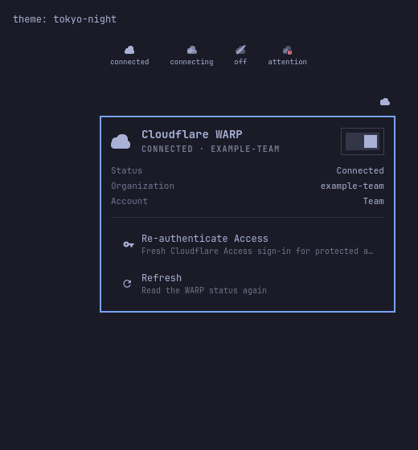
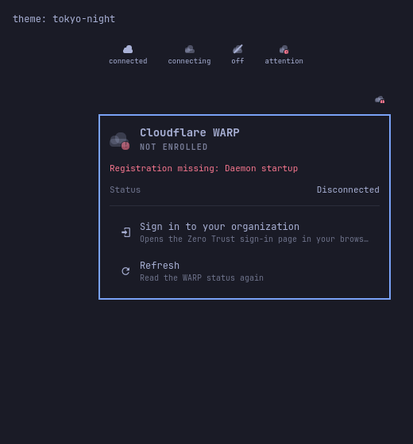
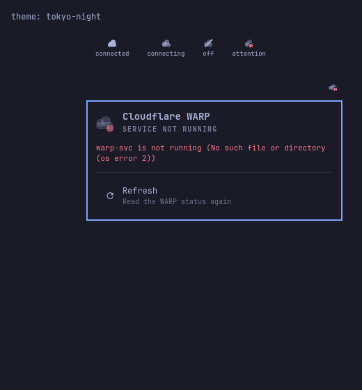
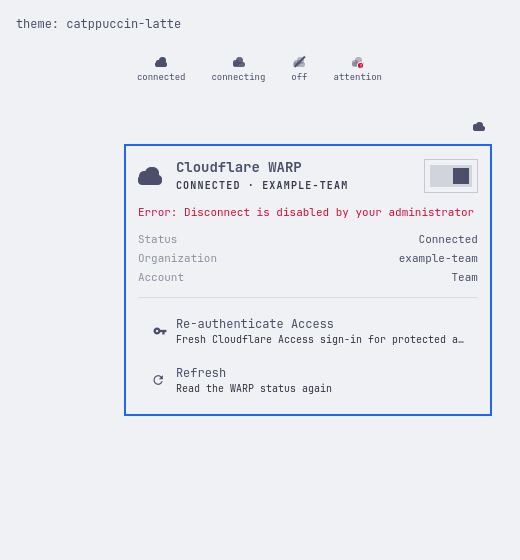

# 9spokes.warp: Cloudflare WARP bar widget

An [Omarchy](https://omarchy.org) bar widget for the Cloudflare One (WARP) client. It draws in the active
theme's bar colours, so a theme switch restyles it with the rest of the bar.



| State | Bar icon |
|---|---|
| Connected | solid cloud |
| Connecting / disconnecting | pulsing cloud |
| Disconnected / paused | faded cloud with a slash |
| Not enrolled, service down, unable, unknown | faded cloud with the theme's urgent `!` badge |

- **Left click** opens a panel: state, reason, organization, a connect switch, and actions (sign in when not enrolled, re-authenticate Access when connected, refresh).
- **Right click** connects or disconnects. Middle click refreshes.
- **Keyboard** in the panel: `j`/`k` or arrows, `enter`, `t` toggle, `r` refresh, `esc`.
- **IPC:** `omarchy-shell 9spokes.warp status|toggle|open|close|refresh|connect|disconnect|signIn`.

State comes from `warp-cli -j status`, polled every `refreshIntervalSec`. A long-running
`warp-cli -l status` prints on each daemon change, and every line triggers a re-poll; its
format isn't parsed. A disconnect that policy refuses shows the daemon's message in the
panel. Sign-in runs in its own process and is abandoned after 5 minutes.

## Requirements

- Omarchy 4.5 or later (the `omarchy-shell` bar with `bar-widget` plugins).
- The Cloudflare One client: `warp-cli` on `PATH` and `warp-svc` running. Cloudflare
  ships no Arch package; build it from Cloudflare's signed Ubuntu `.deb` or use AUR
  `cloudflare-warp-bin`. The widget doesn't need Cloudflare's `warp-taskbar`, and it
  shows "service down" or "not installed" when the client is missing.
- The widget calls `warp-cli` with `--accept-tos`, which accepts Cloudflare's terms of
  service on the user's behalf.

## Install

```bash
omarchy plugin add https://github.com/9spokes-oss/omarchy-warp.git --enable --yes
```

To update, run `omarchy plugin update 9spokes.warp`. To remove it, run
`omarchy plugin remove 9spokes.warp`.

## Settings

| Key | Default | Meaning |
|---|---|---|
| `refreshIntervalSec` | 30 | Status poll interval, 5 to 3600 seconds |
| `listenForChanges` | true | Run `warp-cli -l status` and refresh on each daemon event |
| `warpCli` | `warp-cli` | Command used for every call |

## Sign-in

When the device isn't enrolled, **Sign in to your organization** runs
`warp-cli registration new`. With an MDM file (`/var/lib/cloudflare-warp/mdm.xml`) that
names the organization, this opens the browser at the team's Cloudflare Access page.
After sign-in, the browser hands a `com.cloudflare.warp://` link to the client's desktop
handler, which runs `warp-cli registration token`. The widget opens the printed URL
itself if the client doesn't.

## Development

- `make test` runs the state model (`Model.js`) against captured `warp-cli` output under
  Node.
- `tests/harness/run.sh <out-dir> <theme> <states>` renders the widget offscreen on an
  Omarchy machine with a fake `warp-cli`, using a throwaway `HOME`. It needs no
  compositor, root or WARP install. For example:

  ```bash
  tests/harness/run.sh /tmp/shots tokyo-night connected,unregistered,daemon-down
  ```

The screenshots in [`screenshots/`](screenshots/) come from that harness.

| | |
|---|---|
|  |  |
|  |  |

## License

MIT. See [LICENSE](LICENSE). Cloudflare and WARP are trademarks of Cloudflare, Inc.;
this project is not affiliated with Cloudflare.
